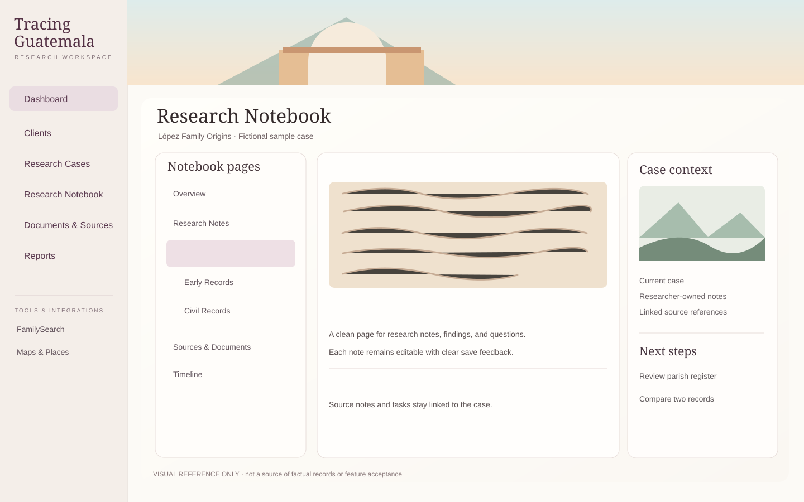

# Tracing Guatemala — calm research workspace facelift

**Planning / visual reference only, not a runtime asset release.** Design owner direction 2026-11-06. Related to [Phase 3 Research Notebook #145](https://github.com/krunchyMonkey/tracing-guatemala-desktop/issues/145). Current Phase FIX privacy #208 and researcher acceptance remain higher-priority gates. No Live deployment, local host restart or data migration is authorized by this design set.

## Intent

Bring the application closer to a calm, editorial, spacious and approachable research environment reminiscent of the restrained information hierarchy of LDS.org, **without copying LDS.org's brand, copyrighted design, logo, photography or trade dress**. Preserve Tracing Guatemala's existing warm cream and muted plum identity, with gentle sage and parchment touches. The mockup is a **concept**, not a promise that all future roadmap links/features exist today.

Design theme: **quiet confidence, warm heritage, generous whitespace, useful hierarchy**. Treat illustration as atmosphere, not as research evidence.

## Original visual references (decorative, not real documents)

The original approved-looking photorealistic mockup generated in the discussion should be used as *stylistic guidance*, not implemented literally. The SVG files above are **original concept illustrations** created for this repository; they contain no external image dependencies, client records, photographs of people or restricted genealogy sources. Scenes are illustrative, not historically/geographically accurate documentary images. No new font or external asset CDNs are needed.

### Suggested image roles
| Asset | Where it may help | Important limits |
| --- | --- | --- |
| `antigua-banner.svg` | Optional narrow Research Studio/Notebook hero treatment on larger screens | Croppable, low visual priority, no obstructed headings; avoid on small screens if it pushes work offscreen |
| `archival-notes.svg` | Research Notebook entry/empty-state/editor navigation card | Decorative only; **do not** pretend it's an uploaded original record; no note image attachment/persistence implied |
| `highlands-place.svg` | Optional Maps & Places / contextual project card | Decorative illustration, **not a real geographical map**; no click target to unfinished tools |
| `calm-layout-reference.svg` | Composition, spacing, typography and task flow reference | Not a pixel-perfect screenshot or feature contract; do not mirror placeholder sidebar links that have not shipped |

## Palette and motion guidance

Use/adjust existing `src/renderer/src/styles.css` tokens instead of introducing a parallel theme system.
- **Background:** warm near-white/cream `#FCFAF6`; **surface:** `#FFFEFB`
- **Muted plum:** `#6B405A`; **active plum tint:** `#EEE0E5`
- **Sage:** `#789575` for subtle secondary status only; **paper:** `#F6EFE5`
- **Text:** `#30272C`; **muted body:** `#655E62`; **borders:** `#E7DFD9`
- Existing semantically meaningful error/success/warning states take precedence and must retain accessible contrast.
- Restrained serif display headings; readable system sans body; no external font fetch; no auto-animated hero or flashy status decoration.
- More whitespace and a simpler hierarchy rather than more cards. Prefer one compact action per task, not an extra dashboard of duplicates.

## UX invariants

1. **Feature truth:** Preserve existing routes, case status, authentic live metrics, notebooks, save/conflict/restore flows, timer, source links, Demo/Live banner and account security cues. Do not introduce functioning-looking features that are not shipped. The reference image is aspirational.
2. **Privacy first:** Do not display real private client thumbnails or source images by default; no new uploads, source copying, cross-user exports or public CDN calls. Fictional demo imagery only.
3. **Images are purposeful and optional:** Original bundled assets only. A content photograph requires proven rights and explicit user/source consent; placeholders are never presented as proof. Every image has proper accessible text or is marked decorative.
4. **Responsive:** The actual research actions must stay visible on 390px mobile, 768px tablet and 1440px desktop. Avoid enormous banner and photo grids on narrow screens.
5. **Accessible:** WCAG AA contrast for text and controls, keyboard and visible focus, reduced motion, appropriate headings and landmarks, no essential content conveyed only by color or picture.
6. **Performance/offline:** Self-hosted compressed AVIF/WebP only if legitimate imagery is later licensed/approved; locally bundled SVGs are preferable for this reference set. Lazy-load below-the-fold media; enforce current CSP and public-demo `connect-src 'none'`.
7. **Live isolation:** Design/implementation in an independent worktree or checkout and isolated ports/build/data paths, with fictional fixtures. Never run local web-live E2E or `npm run check` on the machine hosting current Live until demonstrated safe; use GitHub-hosted CI. No Live reboot, Caddy/DNS, production DB, migrations or release promotion.
8. **Researcher approval:** Check screenshots and flows with the researcher before labeling makeover accepted; no auto-approval from a passing build.

## Intended work packages

- Design baseline, image usage, token/typography specification and researcher review (P03-UX-01).
- App shell and Research Studio dashboard refresh (P03-UX-02).
- Case-bound Research Notebook navigation, editor and contextual imagery refresh (P03-UX-03).
- Asset hygiene, accessibility/mobile/performance/demo parity and researcher acceptance (P03-UX-04).

**Scope boundary:** These tickets are *visual-polish extensions under #145*, not a replacement for original Release B–D notebook features (#150–#157). New backend features, real document imaging/citation, AI copilot, family tree, report builder and Maps & Places integrations remain their existing phases.
