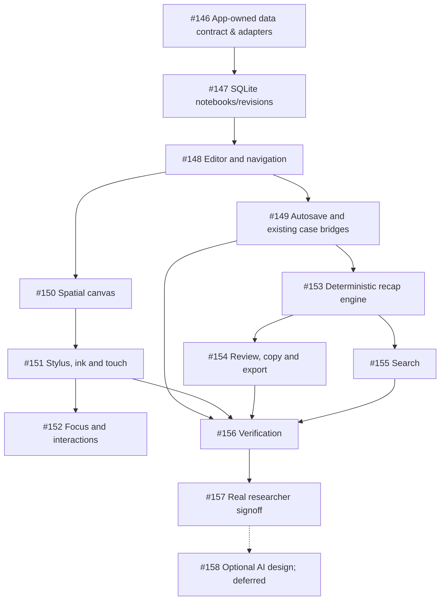

# Phase 3 — Research Notebook & Freeform Canvas

**Decision:** 2026-10-30 · **Project:** Tracing Guatemala, web-first · **Parent tracking issue:** [#145](https://github.com/krunchyMonkey/tracing-guatemala-desktop/issues/145)

## Product goal
Give the researcher a OneNote-like workspace that supports rich notes, organized sections/pages, a spatial scratchpad with pen/touch capability, and useful local deterministic recaps. This **replaces the formerly planned Phase 3 as the next product milestone**. Existing evidence-management issues #22–#31 are *renamed in the forward-looking roadmap* to Phase 4; old GitHub issue identifiers remain unchanged until separately reviewed and relabeled.

**Release order:** A → B → C → D. Each ticket must be independently testable and merged when genuinely finished (see policy below). The actual researcher pilot is not an engineering-only gate.

## Release issues

| Release | Issue | Deliverable |
| --- | --- | --- |
| A | [P03-01 #146](https://github.com/krunchyMonkey/tracing-guatemala-desktop/issues/146) | Notebook schema and replaceable editor/canvas ports |
| A | [P03-02 #147](https://github.com/krunchyMonkey/tracing-guatemala-desktop/issues/147) | Notebook storage, sections, pages and revisions |
| A | [P03-03 #148](https://github.com/krunchyMonkey/tracing-guatemala-desktop/issues/148) | Rich-text scratchpad and navigation |
| A | [P03-04 #149](https://github.com/krunchyMonkey/tracing-guatemala-desktop/issues/149) | Autosave, recovery and case workflow bridge |
| B | [P03-05 #150](https://github.com/krunchyMonkey/tracing-guatemala-desktop/issues/150) | Draggable linked canvas |
| B | [P03-06 #151](https://github.com/krunchyMonkey/tracing-guatemala-desktop/issues/151) | Pen/touch handwriting and tablet layout |
| B | [P03-07 #152](https://github.com/krunchyMonkey/tracing-guatemala-desktop/issues/152) | Focus and visual-note interactions |
| C | [P03-08 #153](https://github.com/krunchyMonkey/tracing-guatemala-desktop/issues/153) | Deterministic non-LLM recap engine |
| C | [P03-09 #154](https://github.com/krunchyMonkey/tracing-guatemala-desktop/issues/154) | Recap review, copy and export |
| C | [P03-10 #155](https://github.com/krunchyMonkey/tracing-guatemala-desktop/issues/155) | Notebook search |
| D | [P03-11 #156](https://github.com/krunchyMonkey/tracing-guatemala-desktop/issues/156) | Backup/security/regression tests |
| D | [P03-12 #157](https://github.com/krunchyMonkey/tracing-guatemala-desktop/issues/157) | Researcher pilot and signoff |
| Deferred | [P03-F01 #158](https://github.com/krunchyMonkey/tracing-guatemala-desktop/issues/158) | Optional AI formalization design |

## Dependency graph

## Canonical content + library decoupling

- Define versioned **application-owned** `Notebook`, `Section`, `Page`, `NoteBlock`, `CanvasScene`, `CanvasElementRef`, `InkLayer`, and `SourceRef` contracts with stable IDs. Case/client ownership verified by Node service; immutable origins and revision provenance.
- Maintain a `NotebookRepository` behind the typed application API and SQLite; no editor-specific JSON, SDK shape or runtime instance escapes to the server contracts.
- React views call adapter-owned ports e.g. `RichTextEditorAdapter` and `CanvasSurfaceAdapter`. Concrete integrations (Tiptap, Excalidraw or alternatives) live under `src/renderer/src/notebook/adapters/<provider>/`. Imports of vendor packages forbidden outside their adapter folder and the composition root.
- The canvas stores links to canonical `NoteBlock` IDs, never an independent copy of text. Prefer storing portable transforms/edges and an app-owned ink model. If exact SDK feature fidelity requires native scene state, isolate it in an explicit `provider`/`schemaVersion` payload and provide versioned migration + portable export.
- Save/export/load round trips are verified against a fake adapter (including a replacement mock provider) before considering any library integration complete.
- Favor permissively licensed, replaceable SDKs; avoid cloud-only functionality, and review license before adding a commercial dependency. Do not claim handwritten text recognition in the initial release.

## No-LLM recap contract

**Inputs:** user's explicit headings/labels (`Found:`, `Question:`, `Source:`, `Next:`), notebook blocks, checklist states, source links, case journal, tasks and existing tracked research sessions.

**Outputs:** deterministic dated case/day/week recap with activity counts and linked exact excerpts, open questions, explicitly recorded sources and next steps, plus copy and Markdown/text export. No inference that similar names belong to the same person; no automatically accepted facts/hypotheses. Plain prose is optionally extractively quoted, with an original block link. Unknown meanings remain unknown.

**Non-goals:** AI-generated narrative synthesis, semantic contradiction detection, handwriting-to-text/OCR, network providers, cloud API calls and autonomous research changes. [#158](https://github.com/krunchyMonkey/tracing-guatemala-desktop/issues/158) is explicitly deferred until the notebook pilot and existing AI privacy/approval issues #32, #38 and #39.

## Data isolation and deployment

- Phase 3 work targets existing React/Vite web app, SQLite on the host, typed same-origin Node API, HTTP security boundaries and fictional demo adapter. Preserve Electron, pause desktop feature work.
- HTTP LAN live (#134/#138) is **fictional-only**. Real client records from any second device require [#139](https://github.com/krunchyMonkey/tracing-guatemala-desktop/issues/139) HTTPS/security readiness and the owner's explicit approval. Do not route notebook records through a public hosted application.
- Keep backups atomic across notebook and eventual authorized attachments, with reliable checksum/restore and rollback; archived case remains read-only.
- The project repository is PUBLIC. No actual client identifiers, private documents, credentials, research notes, or LAN details in source, GitHub issues, PRs or test screenshots.

## PR workflow — owner standing instruction

For **routine** Phase 3 engineering/docs PRs, **merge as soon as genuinely finished**, instead of leaving completed PRs open. Use a focused small PR per ticket; re-read current `main` and dependencies, reuse an existing checkout/worktree, and do not open misleading independent PRs on unmerged prerequisite code.

Merge gate: acceptance criteria complete, review comments resolved, lint/typecheck/unit + relevant SQLite/API/Playwright checks actually run and recorded, new UI/screenshots fictional, privacy and regression concerns addressed, head/base verified and no unresolved dependency. Prefer squash. Verify GitHub reports the PR merged; then update ticket/handoff and proceed to next unblocked ticket.

**No unconditional auto-merge**, no merge on failing/unknown tests, and do not override a real researcher/owner security approval gate. #21 and #157 remain open until the actual user performs and approves the corresponding pilot; #138 and #139 retain explicit LAN/security owner decisions. Do not merge unrelated pre-existing PR #111 without inspecting its scope/reviews first.

## Follow-on phase numbering

| Current planned phase | Revised future roadmap |
| --- | --- |
| New notebook | **3: Notebook & Freeform Canvas** |
| 3: Document & Evidence | **4: Document & Evidence** |
| 4: AI Documents | **5: AI Documents** |
| 5: Client Reports | **6: Client Reports** |
| 6: Family Trees | **7: Family Trees** |
| 7: AI Copilot | **8: AI Copilot** |
| 8: External Integrations | **9: External Integrations** |
| 9: Business Growth | **10: Business Growth** |

Existing issue numbers remain stable, preserving traceability. Historical `[P03-]` prefixes on old evidence tickets reflect their original catalog numbers; use an explicit old/new mapping when touching them instead of rewriting internal issue IDs without review.

## Definition of done

The researcher can create/edit a notebook, write and draw with a touch/pen device, arrange one canonical note across rich-text and spatial views, recover all content after save/restart/backup, generate a local non-LLM recap, and complete a privacy-safe pilot. **Real researcher signoff** is required before marking the milestone accepted.
