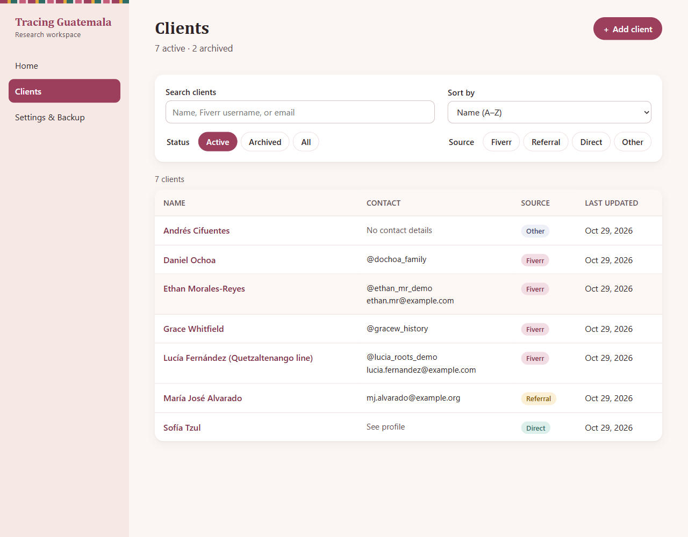
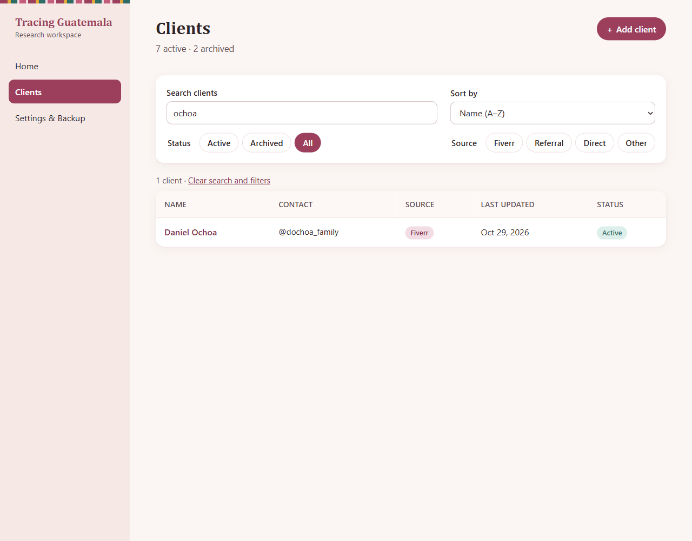
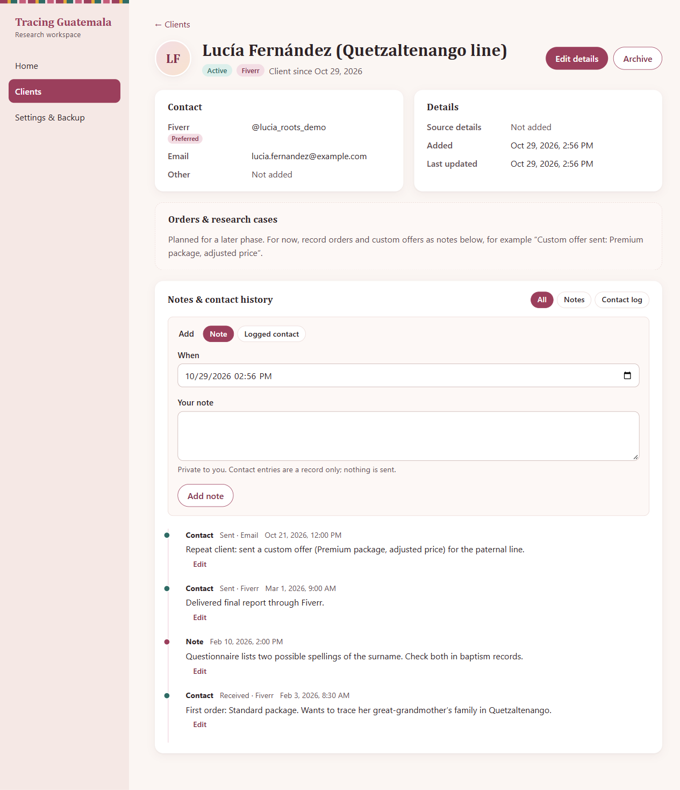
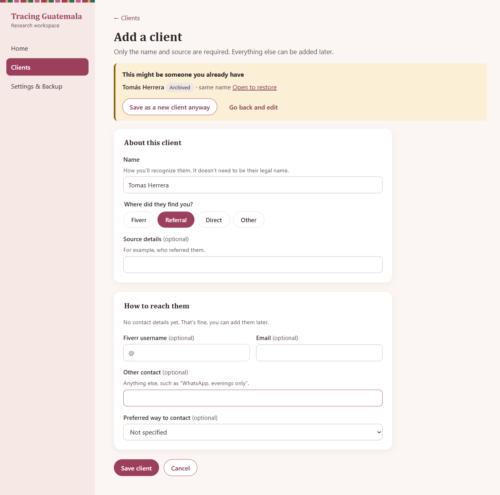
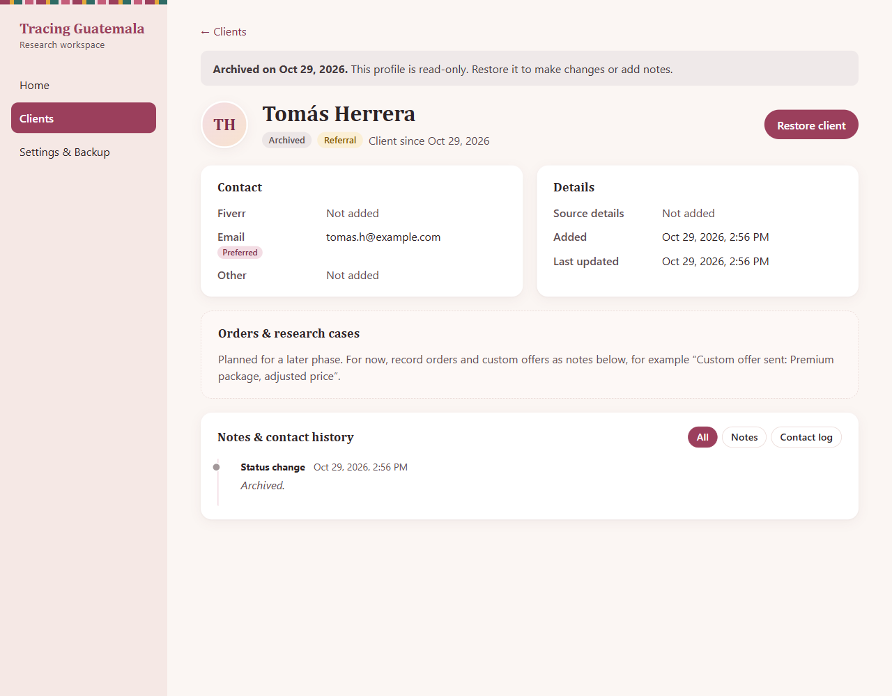
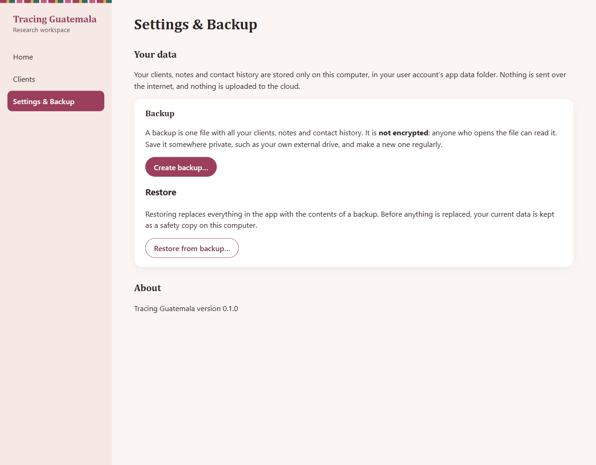

# Phase 1 pilot guide (#12)

**Status:** Ready to run once the #5–#11 pull requests are merged. **Not yet run.** No researcher feedback or approval has been recorded. The sections at the end stay empty until the session happens.

**Who uses this:** the project owner runs the session; the researcher uses the app and gives feedback. Allow about 60–75 minutes.

**What is being validated:** the working `client-model/v1` defaults and the client screens. They were authorized by the project owner so that building could continue. The researcher has not reviewed or approved them yet. This session is where her review happens.

## 1. Before the session (project owner)

- [ ] Merge PRs #98 → #99 → #101 → #103 → #104 → #105 → #106 in that order. Confirm `npm run check` passes on `main`.
- [ ] **Choose the first pilot OS**, the researcher's own computer. Only Windows has been built and exercised so far.
  - Windows: `npm run package` produces `release/Tracing Guatemala Setup 0.1.0.exe`, a per-user NSIS installer.
  - macOS or Linux: these must be built on that OS. Rerun `npm run package:dir` and `npm run smoke:packaged` there first.
- [ ] Explain the **unsigned installer** warning. On Windows, SmartScreen says "Windows protected your PC": choose *More info → Run anyway*. Code signing is not set up in Phase 1.
- [ ] Install on the researcher's computer, open the app, and check that Home appears.
- [ ] Read [Local data, privacy and backups](../privacy-and-backup.md) together. In particular:
  - data lives only on this computer;
  - it is **not encrypted**;
  - backups are unencrypted single files;
  - turning on disk encryption (BitLocker or FileVault) is recommended.
- [ ] Use **fictional clients only** during the walkthrough. Decide together, at the end, whether real client information may be entered.

## 2. Walkthrough tasks (researcher)

Ask her to think aloud. Note where she hesitates, what she expects to happen, and anything she looks for and can't find. The owner should not explain the screen unless she is stuck for more than a minute.

| # | Task | What it checks |
| --- | --- | --- |
| 1 | Add a new client you might get from Fiverr, with only a name and source. Then add their Fiverr username and email. | Create and edit; required fields (Q1, Q2) |
| 2 | Close the app completely and open it again. Find that client. | Persistence |
| 3 | Add a note about what they ordered. Log a message you sent them on Fiverr yesterday. | Notes, back-dated contact log (Q8) |
| 4 | Fix a typo in that note. | Edit and the *Edited* marker |
| 5 | Search for a client by part of their name without accents, then by email. Show only referral clients. | Search and filters |
| 6 | A past client comes back for a new order. Find them and record the custom offer you sent. | Repeat-client scenario (Q8) |
| 7 | Archive a client you no longer work with. Find them again and restore them. | Archive and restore; read-only while archived (Q4, Q5, Q6) |
| 8 | Add a client who already exists, typing their name slightly differently, such as without accents. | Duplicate advisory: warn, don't block (Q7) |
| 9 | Make a backup to a USB drive or a folder. Add one more client, then restore the backup. | Backup and restore; safety copy |
| 10 | Is there anything you'd look up about a client every week that isn't here? | Missing fields (Q3, Q10) |

Screenshots of these screens with fictional data are in [`docs/screenshots/mvp/`](../screenshots/mvp/):

| Directory  | Search with *All*  |
| --- | --- |
| Profile with notes and contact log  | Duplicate advisory (archived match)  |
| Archived, read-only profile  | Settings & Backup  |

To refresh them: `npm run build`, then `CAPTURE_SCREENSHOTS=1 npx playwright test mvp-screenshots`.

## 3. Questions to ask after the tasks

Use her own words where possible.

**Data model.** Ask checklist questions Q1–Q10 in [client-data-model.md](../client-data-model.md#researcher-approval-checklist-deferred-to-integrated-mvp-review-non-blocking). These are especially important:

- **Q9, permanent deletion.** Does she ever need to delete a client completely, for example if they ask her to? Phase 1 can only archive.
- **Q4, statuses.** Are *Active* and *Archived* enough?

**Screens.** Ask the 8 design questions in [client-directory.md](../prototypes/client-directory.md#working-design-defaults--collect-feedback-at-the-integrated-mvp-pilot). They cover the table layout, the default view and sort, the source chips, read-only archived profiles, the duplicate warning, contact-log detail, the orders placeholder, and the look and feel.

**Implementation choices made during #5–#11.** These were reasonable defaults, but she should confirm them:

| Topic | Current behaviour | Ask |
| --- | --- | --- |
| Note history | Edited notes keep only the latest text and show "Edited <date>". | Does she need to see what a note said before? |
| Note dates | Can be back-dated freely; more than a day in the future is refused. | OK? |
| Deleting notes | Not possible. | Does she need to remove a note, for example one added to the wrong client? |
| Duplicate matching | Exact after ignoring accents, case, spacing and punctuation. "Ana Ejemplo" and "Ana Ejemplos" are not flagged. | Too strict, or about right? |
| Backups | Manual, unencrypted, all-or-nothing restore. Safety copies are kept forever. | How often would she back up, and where? Is a reminder needed? |

## 4. Feedback record

*Fill in during or right after the session. Link each must-fix or should-fix item to a new GitHub issue. Fictional data only in issues: describe problems without real client details.*

| # | Observation (her words where possible) | Task / question | Severity (must-fix / should-fix / later) | Issue |
| --- | --- | --- | --- | --- |
| | | | | |

Must-fix items are fixed and re-checked with her before sign-off.

## 5. Sign-off record

*Leave blank until the researcher has used the app and decided. Do not fill in on her behalf.*

- Date of session:
- OS and installer used:
- Real client information approved for entry: ☐ yes ☐ not yet
- Researcher's decision: ☐ Approved for Phase 1 ☐ Approved after the must-fix issues listed above ☐ Not approved (blockers below)
- Remaining blockers, if any:
- Recorded by:
