# Client directory and profile — clickable prototype (#3)

**Status:** **Owner-authorized working UI baseline.** This clickable prototype and the v1 client model are approved for engineering implementation; they have **not** received researcher feedback. Present the integrated persisted MVP to her at #12 for actual feedback/approval. This guide remains useful for that walkthrough.

**What it is:** The real app's Clients section, running on **fictional, in-memory sample data**. Nothing is saved: closing or reloading the app resets everything. There is no database, no IPC for client data, and no network access. The Electron security model from #4 is unchanged.

## How to open it

Requires Node.js 22.12 or newer.

```sh
npm install
npm run dev          # development window with hot reload
# or, closer to the shipped app (production CSP, app:// origin):
npm run build && npm run preview
```

Then choose **Clients** in the sidebar.

> In a VS Code terminal, run `unset ELECTRON_RUN_AS_NODE` (bash) or `Remove-Item Env:ELECTRON_RUN_AS_NODE` (PowerShell) first if the window never appears.

The yellow **Prototype for review** strip on each Clients screen is for reviewers only and is not part of the design:

- **Show empty directory / Load sample clients** switches between the first-run empty state and the sample data.
- **Simulate save errors** makes every save, archive, restore and note fail, to show the error states.

## Suggested review walkthrough (about 10 minutes)

1. **Directory:** search for `lucia` (accents are ignored) and `example.org`. Switch Status to *Archived* and *All*. Toggle the Source chips. Change *Sort by*.
2. **No matches:** search for something that doesn't exist and read the message.
3. **Add a client:** press *Add client* and then *Save client* straight away to see the required-field messages. Fill in a name and a source.
4. **Duplicate warning:** add a client named `Tomas Herrera` (an archived sample client). The app pauses and offers *Open to restore*, *Save as a new client anyway* or *Go back and edit*.
5. **Profile:** open *Lucía Fernández*. Check the contact card, *Preferred* tag, the orders placeholder and the history.
6. **Notes and contact log:** add a note, then a *Logged contact* entry. Filter the history.
7. **Archive and restore:** archive a client (with confirmation), see the read-only profile, then restore it.
8. **Edit:** edit a client, set *Preferred way to contact* to *Email* with no email, and save. Then press *Cancel* with unsaved changes.
9. **Errors:** tick *Simulate save errors* and try saving.
10. **Keyboard only:** press <kbd>Tab</kbd> from the top. The *Skip to content* link appears; every control shows a visible focus ring. <kbd>Esc</kbd> closes confirmation dialogs.

## Screenshots

All data shown is fictional.

| | |
| --- | --- |
| Directory (active clients, default) 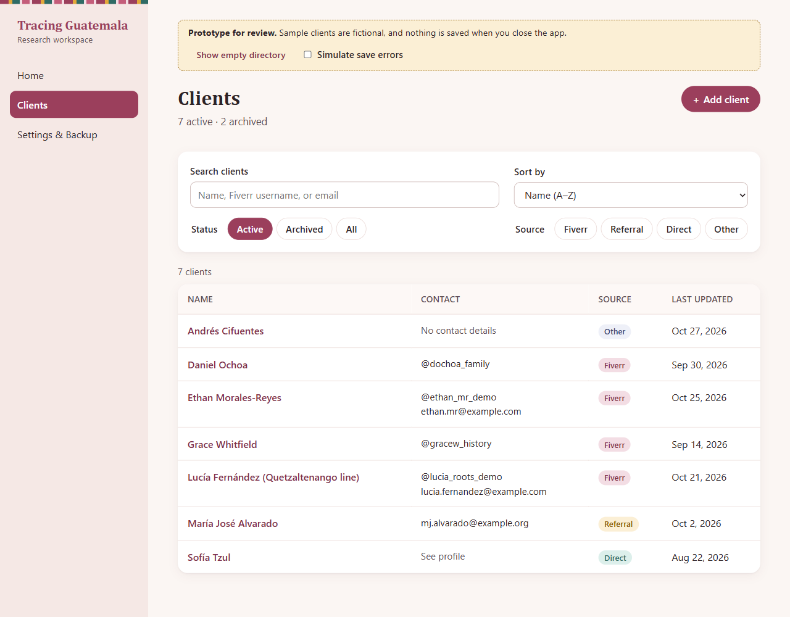 | No matches 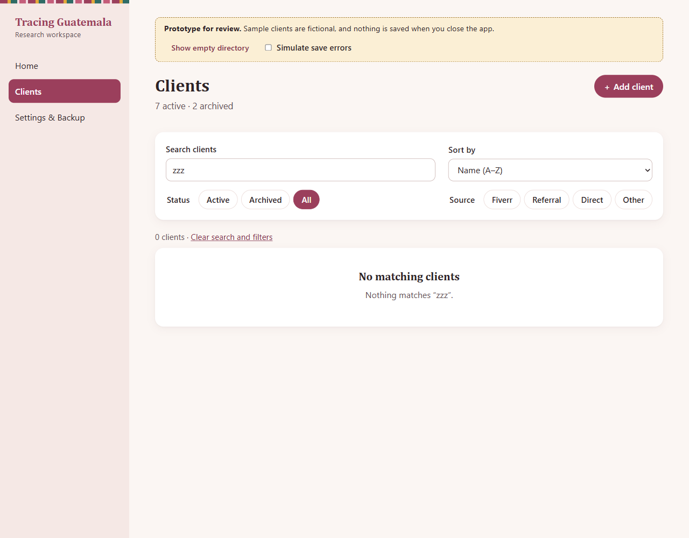 |
| All statuses, Fiverr only, recently updated 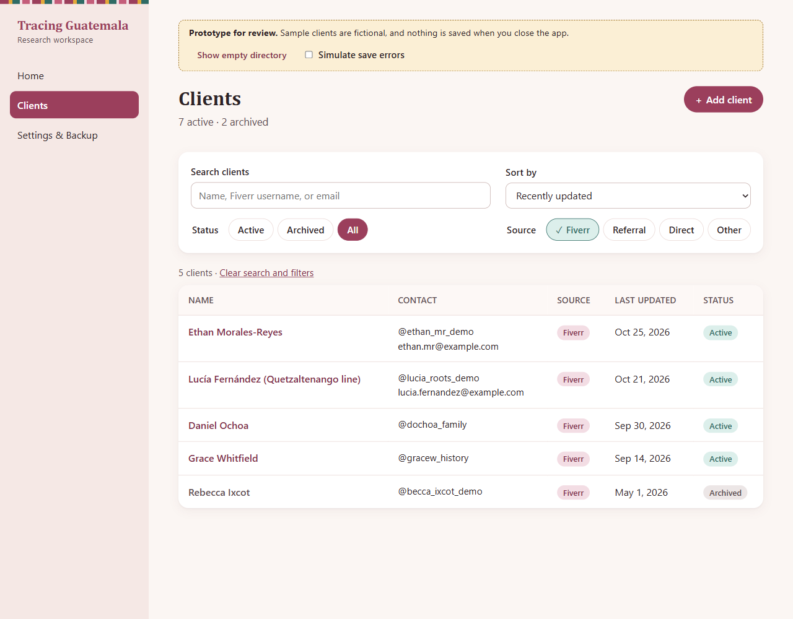 | First-run empty state 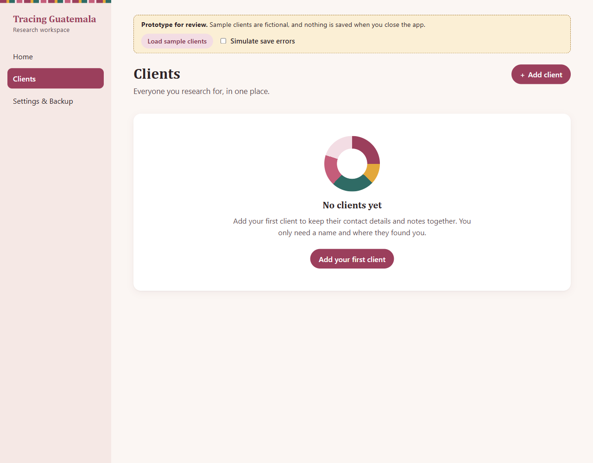 |
| Add: required-field errors 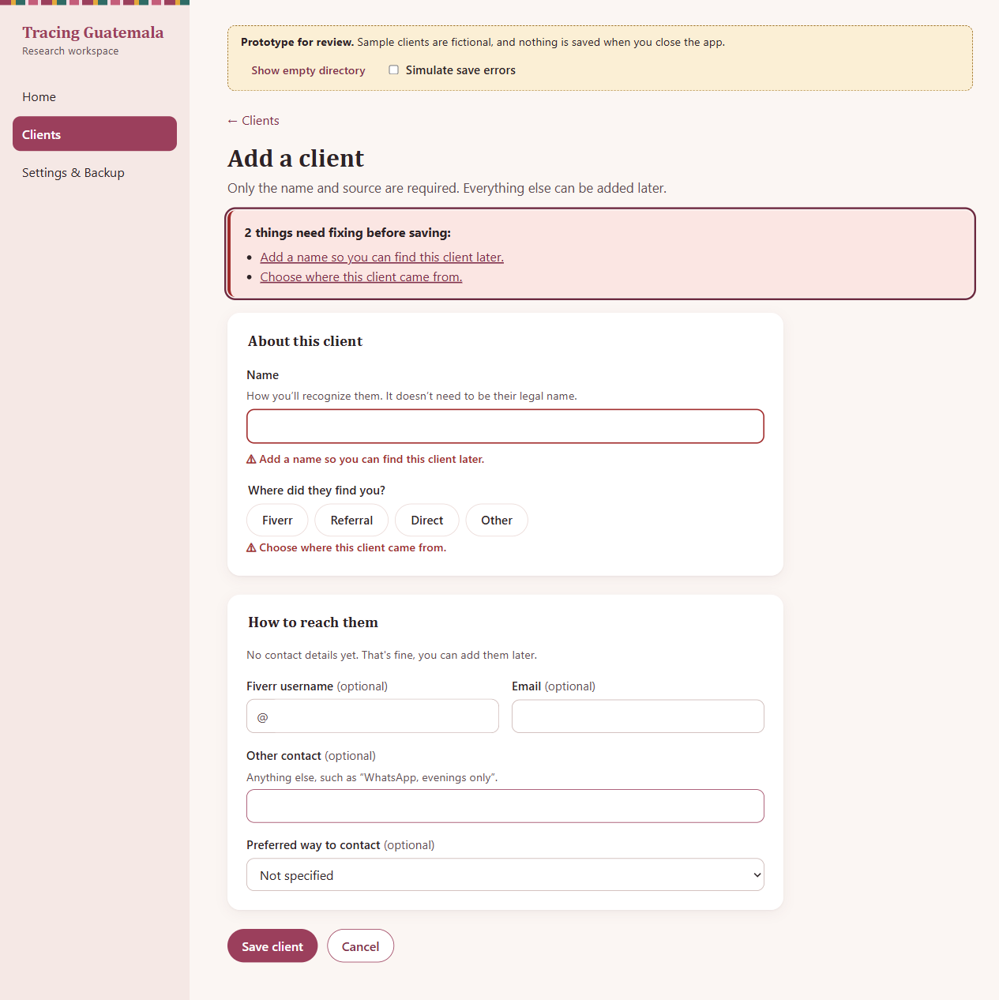 | Add: possible duplicate (archived) 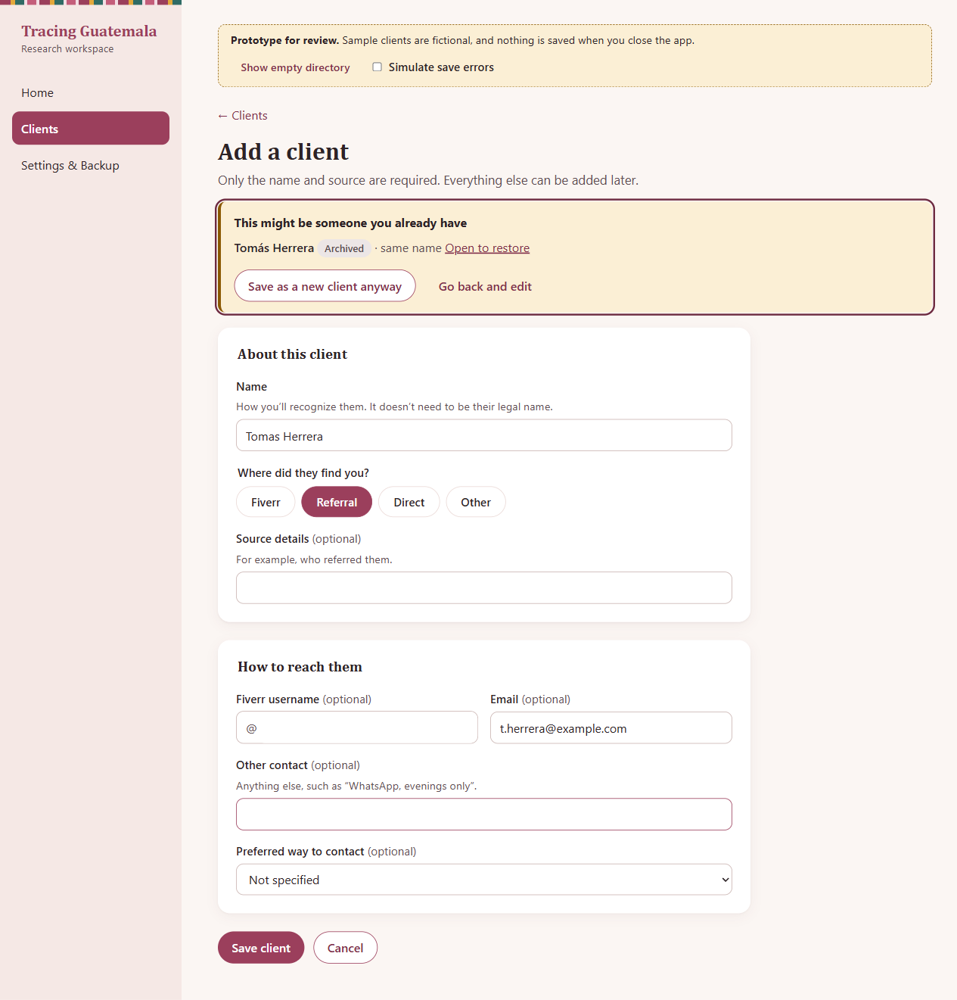 |
| Profile 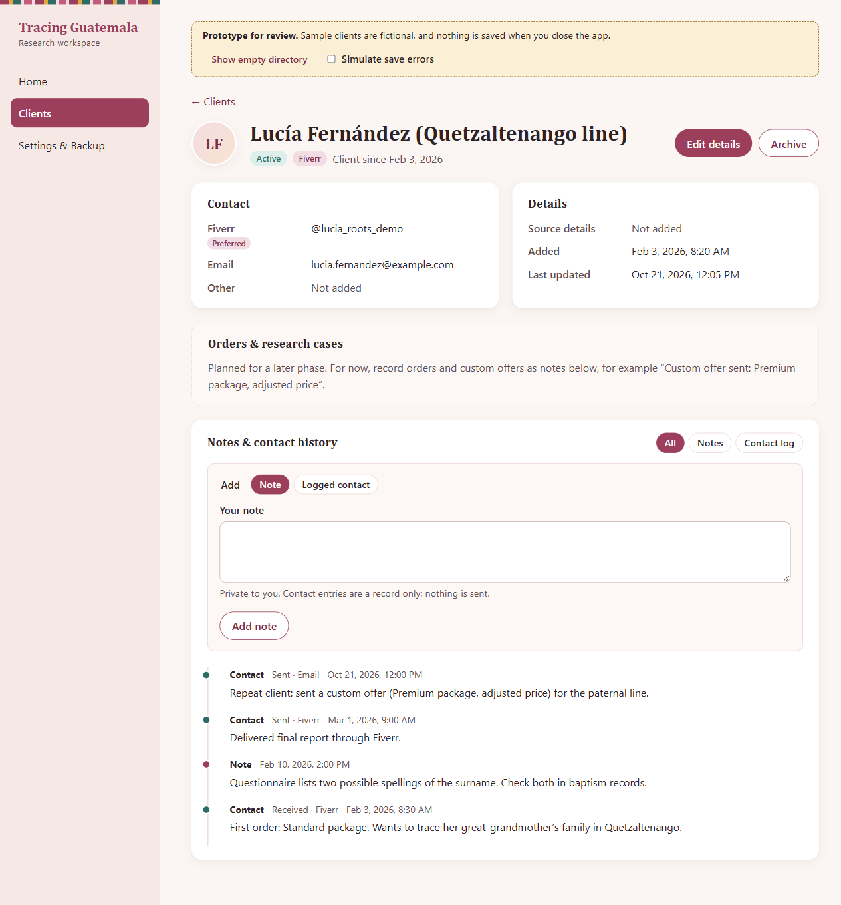 | Archive confirmation 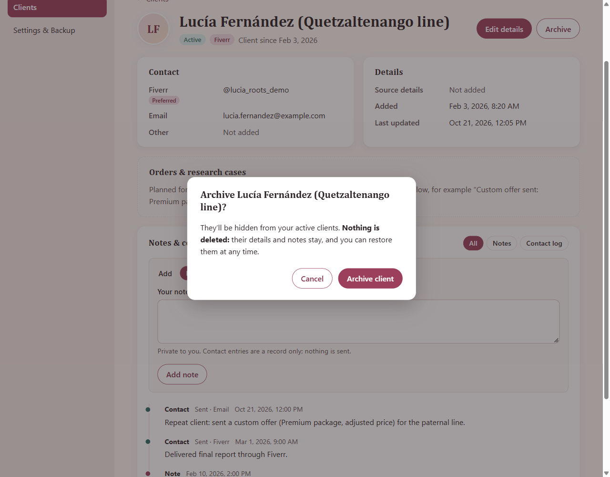 |
| Archived, read-only profile 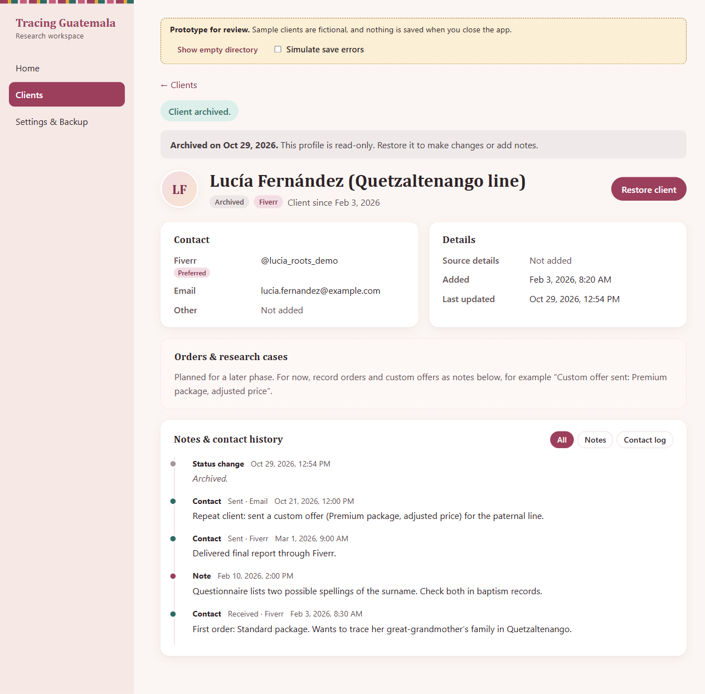 | Edit: preferred-channel rule 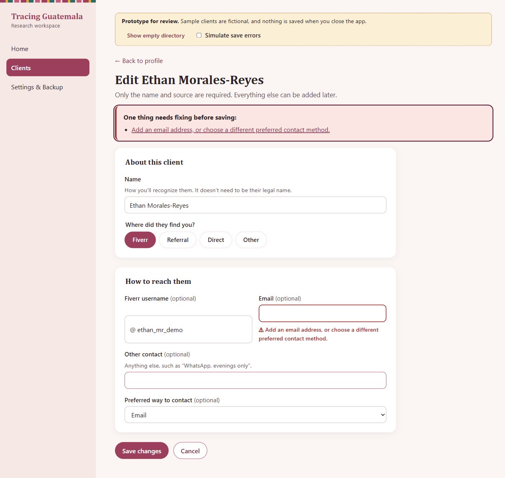 |
| Save failure keeps your text 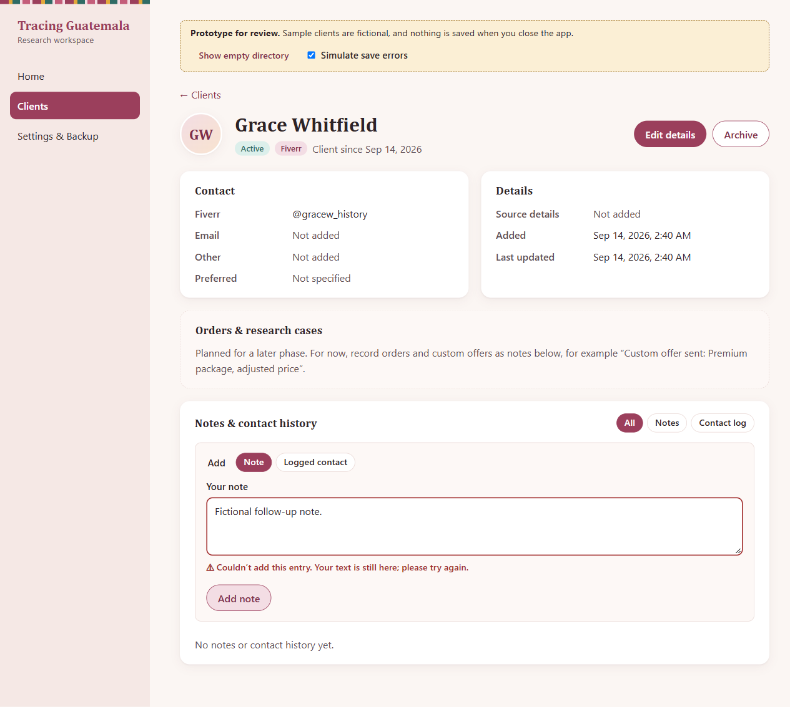 | |

To refresh them after a design change: `npm run build`, then `CAPTURE_SCREENSHOTS=1 npx playwright test prototype-screenshots`.

## Coverage of the #3 acceptance criteria

| Criterion | Where to see it |
| --- | --- |
| Search, filtering, sorting | Directory toolbar; filters stay in the URL, so coming back from a profile keeps them. |
| Add, edit, detail | *Add client*, *Edit details*, profile page. |
| Notes | Profile → *Notes & contact history* (notes, logged contacts, status changes). |
| Archive and restore | Profile actions, with confirmation and a read-only archived view. |
| No clients, no matches | Empty directory; no-matches panel with *Clear search and filters*. |
| Validation and duplicates | Error summary with links to fields, inline messages, non-blocking warnings, duplicate pause. |
| Errors and confirmation | *Simulate save errors*; confirmations for archive, restore and discarding edits. |
| Optional-field handling | "(optional)" labels; blank values shown as *Not added*. |
| Accessible focus, readable type | 16px base text, 3px focus ring, labeled controls, error summary focus, dialog focus trap, skip link. |
| Gentle modern/feminine styling, fictional data | Rose and plum palette with teal and marigold accents, serif headings, soft cards, and a woven-band accent inspired by Guatemalan textiles. All sample people are invented. |
| **Researcher feedback and approved design** | **Deferred to the integrated MVP pilot (#12).** Not a blocker for #5–#11. |

## Working design defaults — collect feedback at the integrated MVP pilot

These are project-owner-authorized implementation assumptions, not the researcher's recorded preferences. Continue building with them and revisit during #12.

1. **Directory as a table** (name, contact, source, last updated), not cards. Is this what you scan for every day?
2. **Default view is Active clients**, sorted by name. Would *Recently updated* be a better default?
3. **Source chips are always visible.** Are they useful, or is search enough?
4. **Archived profiles are read-only**, including notes, until restored (#2 checklist Q5).
5. **Duplicate check warns but never blocks** (#2 Q7).
6. **Contact log entries are typed in by hand** and never sent anywhere. Is "Sent / Received + channel" the right amount of detail?
7. **Orders and research cases** are a placeholder; orders and custom offers are written as notes until a later phase (#2 Q8).
8. **Look and feel:** colors, serif headings, the textile band. What would make it feel more like Tracing Guatemala?

## Implementation notes for #6–#10

- `src/renderer/src/clients/model.ts` holds the provisional types, validation, duplicate detection and directory query as pure functions. The rules are written so they can move to the main process. #5 and #10 must re-run validation there, because the renderer is untrusted.
- `ClientStore.tsx` is the only piece to replace. Its methods map one-to-one to the proposed IPC channels in `docs/architecture/client-storage-readiness.md`.
- The prototype adds no IPC channels, dependencies or network access. The e2e smoke test now also walks the client screens under the production CSP and checks that no violations occur.
